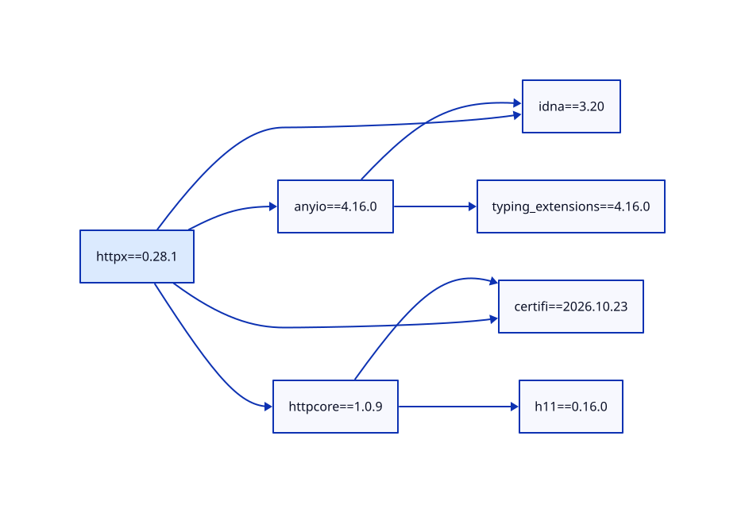
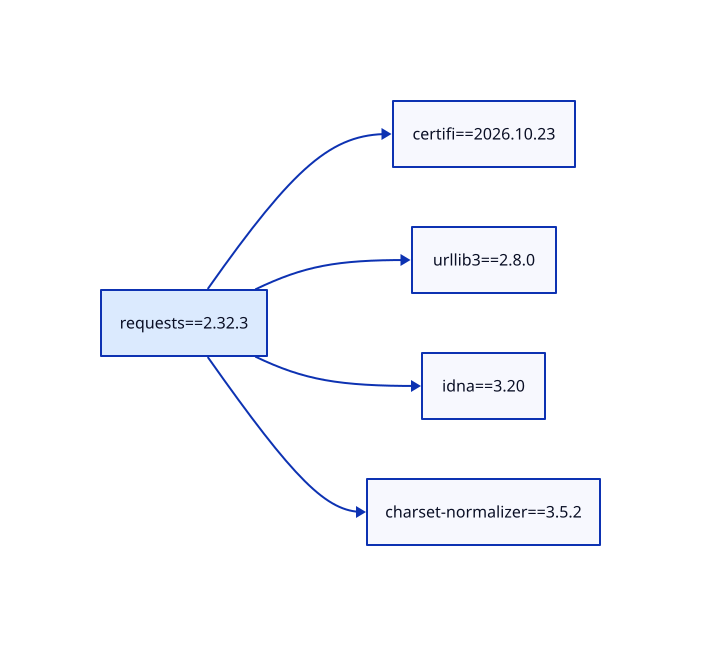
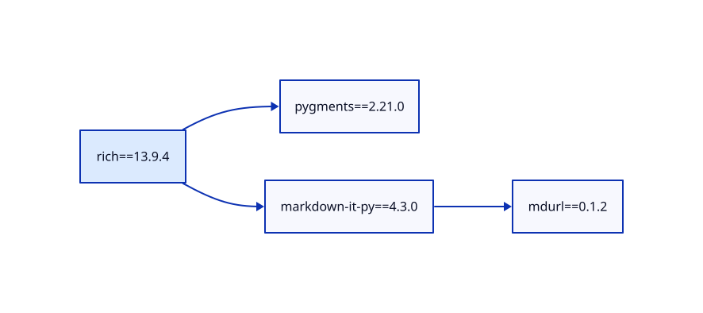

# Сравнение этапов 4 и 5

Проверено 12 ноября 2026 года на Linux, Python **3.14.8**.
Рендерер: **D2 0.9.0**. Независимый визуализатор: **pipdeptree 2.30.0**
с Graphviz. Корневые версии фиксированы, версии дочерних пакетов выбраны
по доступным на момент проверки данным PyPI.

## Как получены результаты

Собственный сборщик получал сведения через Simple API и `.metadata`.
Для каждого пакета выбран `max_depth=100`, фильтр выключен, extras корня
не заданы. Все обнаруженные ветки этих трёх примеров закончились раньше
границы глубины.

Для сравнения pip действительно установил каждый пакет в отдельное
окружение внутри `hw2/.cache/reference-envs/`. Порядок зафиксирован из строки
`Installing collected packages` в журнале установки. JSON-отчёт pip
используется как подтверждение состава установки, а не порядка.
pipdeptree независимо прочитал установленные пакеты и сформировал JSON и SVG.

Нормализация при сравнении объединяет варианты `typing_extensions` и
`typing-extensions`, а также эквивалентные записи версий. Сравниваются
направленные рёбра и версии, а не только количество узлов.

| Пакет | Узлы: приложение / pipdeptree | Рёбра: приложение / pipdeptree | Различия состава | Проверка обоих порядков |
| --- | --- | --- | --- | --- |
| `httpx==0.28.1` | 7 / 7 | 8 / 8 | Нет | Оба корректны |
| `requests==2.32.3` | 5 / 5 | 4 / 4 | Нет | Оба корректны |
| `rich==13.9.4` | 4 / 4 | 3 / 3 | Нет | Оба корректны |

Все исходные результаты доступны в [summary.json](results/summary.json).

## Порядок загрузки

Здесь приведены нормализованные имена. Точные версии находятся в `order.txt`,
`graph.json`, `pip-report.json` соответствующего примера.

### httpx

Приложение:

```text
certifi → h11 → httpcore → idna → typing-extensions → anyio → httpx
```

pip:

```text
typing-extensions → idna → h11 → certifi → httpcore → anyio → httpx
```

В обоих вариантах `httpcore` идёт после `certifi` и `h11`, `anyio` — после
`idna` и `typing-extensions`, а `httpx` — после всех своих зависимостей.
Пакеты без взаимной зависимости разрешено переставлять.

[Данные сравнения](results/httpx/comparison.json),
[журнал pip](results/httpx/pip-install.log).

### requests

Приложение:

```text
certifi → charset-normalizer → idna → urllib3 → requests
```

pip:

```text
urllib3 → idna → charset-normalizer → certifi → requests
```

Четыре прямые зависимости не зависят друг от друга. Поэтому обе
последовательности допустимы; `requests` в обоих случаях находится в конце.

[Данные сравнения](results/requests/comparison.json),
[журнал pip](results/requests/pip-install.log).

### rich

Приложение:

```text
mdurl → markdown-it-py → pygments → rich
```

pip:

```text
pygments → mdurl → markdown-it-py → rich
```

`markdown-it-py` следует за `mdurl`, а `rich` — за `markdown-it-py` и
`pygments`. Положение независимого `pygments` различается и не нарушает
ни одного ограничения.

[Данные сравнения](results/rich/comparison.json),
[журнал pip](results/rich/pip-install.log).

### Почему порядок отличается

Алгоритм приложения выбирает минимальную строковую подпись среди готовых
узлов. pip не обязан использовать такое правило для независимых пакетов.
Его [документация](https://pip.pypa.io/en/stable/cli/pip_install/#installation-order)
гарантирует только установку зависимостей раньше родителей. Скрипт сравнения
проверил это условие для каждого ребра в обоих результатах.

Циклический тестовый репозиторий проверяется отдельно:
`bash hw2/examples/run_stage4.sh`. Приложение сообщает об отсутствии
строгого порядка. pip для циклов применяет своё правило разрыва, поэтому
поведение здесь намеренно отличается. Визуализация сохраняет цикл целиком.

## Визуализация

Стрелка на обоих видах диаграмм направлена от пакета к его зависимости.
D2 использует горизонтальную компоновку и выделяет корень голубым цветом.
pipdeptree с Graphviz располагает узлы иначе и дополнительно подписывает
ограничения версий на рёбрах. Эти различия оформления не меняют состав графа.

### httpx



[Исходный D2](results/httpx/graph.d2),
[эталон pipdeptree](results/httpx/pipdeptree.svg).

### requests



[Исходный D2](results/requests/graph.d2),
[эталон pipdeptree](results/requests/pipdeptree.svg).

### rich



[Исходный D2](results/rich/graph.d2),
[эталон pipdeptree](results/rich/pipdeptree.svg).

## Воспроизведение и ограничения

Из корня проекта:

```bash
.venv/bin/python -B hw2/tools/install_d2.py
.venv/bin/python -B -m hw2.tools.compare_with_pip
```

Для повторения одного примера:

```bash
.venv/bin/python -B -m hw2.tools.compare_with_pip --package requests==2.32.3
```

Нужны сеть, pip в исходном интерпретаторе и системный `dot`. Все новые
окружения, кеши и временные файлы скрипта размещаются внутри `hw2/`.
Окружение проекта не обновляется. `pipdeptree` используется только
для эталонного сравнения и не вызывается приложением при сборе зависимостей.

Полное совпадение этих примеров не делает приложение заменой resolver pip.
У него пока нет глобального согласования версий разных веток и полноценного
отбора файлов по совместимости Python и платформы. При других условиях
это может привести к расхождениям. При повторении позже могут измениться
выбранные дочерние версии, поскольку новые релизы на PyPI не зафиксированы.
